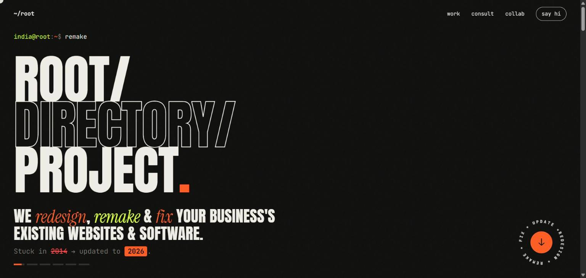
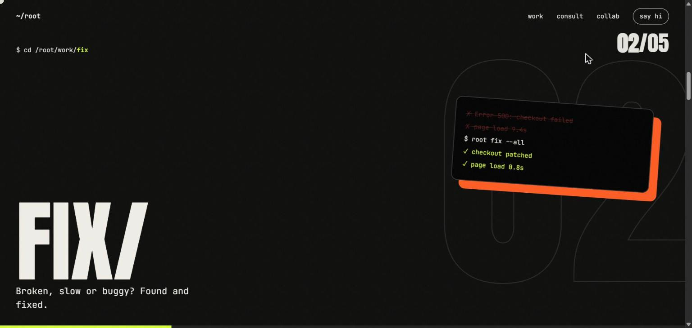
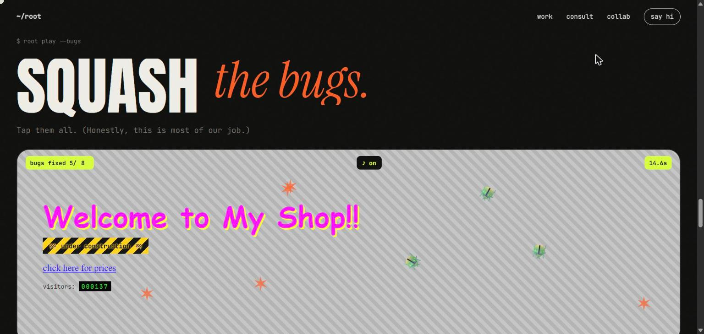
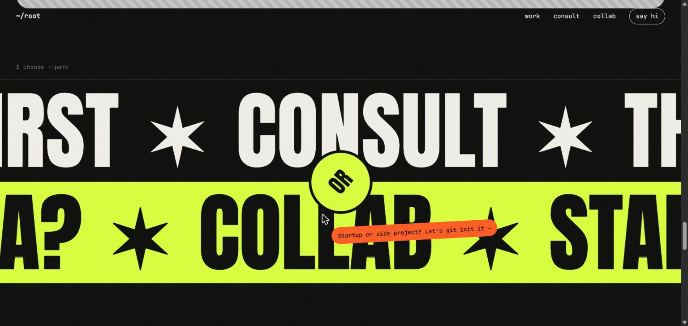
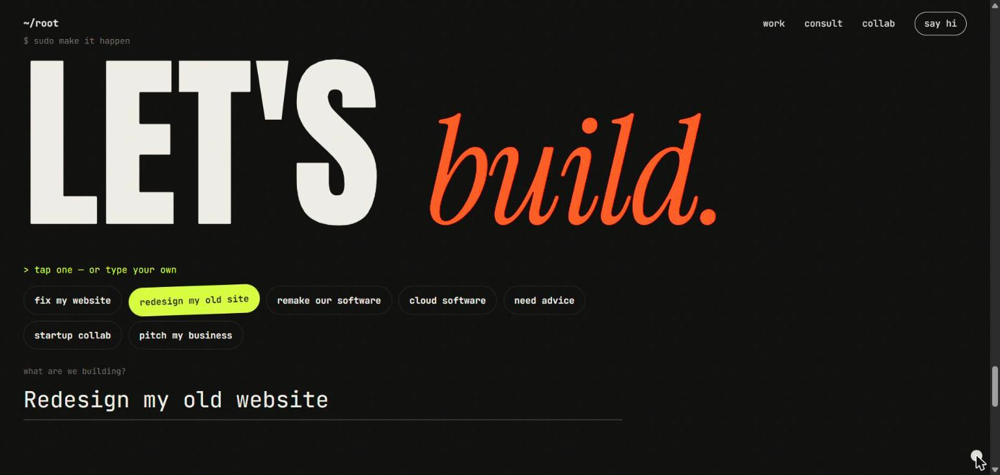

<div align="center">

<a href="https://raghav1000000000.github.io/root-directory-project/">
  
</a>

# `RAGHAV/` `MITTAL.`

**We redesign, remake & fix your business's existing websites & software.**<br>
Plus cloud software, consulting and startup collabs. Tech & automation studio, India first.

[**→ Open the live site**](https://raghav1000000000.github.io/root-directory-project/) &nbsp;·&nbsp; [What's inside](#-cat-featuresmd) &nbsp;·&nbsp; [Run it](#-npx-serve-)


</div>

---

## `$ whoami`

I'm Raghav Mittal, and I help businesses that are **stuck in 2014**: slow websites, clunky internal software, things held together with tape. I go to the root of it, then redesign, remake or fix it so it works the way business works **today**.

| `ls ./work` | |
|---|---|
| **`remake/`** | Old website or software, redesigned and rebuilt for today |
| **`fix/`** | Broken, slow or buggy, found and fixed |
| **`web/`** | Websites that load fast and actually sell |
| **`cloud/`** | Dashboards, SaaS and backends that never sleep |
| **`automate/`** | Busywork that runs itself |
| **`consult/`** | Talk to us before you spend a rupee on tech |
| **`collab/`** | Startups and wild ideas, built together |

## `$ ./preview`

<table>
  <tr>
    <td width="50%"><br><sub><b>Work</b>: panels slide sideways as you scroll, each with its own animated scene.</sub></td>
    <td width="50%"><br><sub><b>Squash the bugs</b>: a mini game with toy-pistol sounds. Win and the old site turns into a new one.</sub></td>
  </tr>
  <tr>
    <td width="50%"><br><sub><b>Choose a path</b>: giant strips slide with scroll. Hover to fill, click to start the conversation.</sub></td>
    <td width="50%"><br><sub><b>Let's build</b>: one-tap quick picks, an email field and a big SEND IT button.</sub></td>
  </tr>
</table>

## `$ cat features.md`

- **Boot screen**: a quick terminal "upgrade" log plays out before the page appears.
- **Rotating headline**: cycles through what we do: remakes, websites, cloud software, consulting, startups, pitches.
- **Work section**: on desktop, scrolling moves five full-screen panels sideways, each locking in place with a CSS-only scene (a 2000s site wiping into a new one, a terminal fixing bugs, servers passing packets, a conveyor belt of tasks). On phones it's a swipe carousel that also moves by itself, so the page never hijacks your scroll.
- **Service cards**: every service in the nav and footer opens a card explaining it in plain language, with WhatsApp and Gmail buttons. A centred card on desktop, a drag-to-close bottom sheet on phones.
- **Bug-squash game**: toy-pistol sound effects made in the browser with the Web Audio API (no audio files), "POW!" stickers, recoil and a crosshair cursor.
- **Scroll reveals**: titles rise word by word, pills pop in, boxes open from the centre.
- **Desktop hover**: letters dodge the cursor, a custom blend-mode cursor, a magnetic send button, labels that follow the mouse.
- **Phone motion**: hover is replaced by the gyroscope. Tilt to wobble the headline and slide the bugs, shake to scramble the page.
- **Works on touchscreen laptops**: mouse effects switch on when a real mouse moves, not from CSS media queries, which many touch laptops get wrong.
- **Respects reduced motion**: everything stays readable and still for people who turn animation off.
- **Leads land on WhatsApp**: the contact form opens WhatsApp with a friendly, ready-to-send message that includes the project and email.
- **No tracking, no cookies, no framework**: one HTML file, one stylesheet, one script.

## `$ npx serve .`

There's nothing to install or build. Serve the folder with any static server:

```bash
npx serve .
```

Then open `http://localhost:3000`. (Opening `index.html` directly also works, but motion sensors and audio behave best over `http(s)://`.)

## `$ tree`

```text
.
├── index.html          # all the content (deliberately short)
├── styles.css          # design tokens at the top: --hot, --acid, --bg, --ink
├── script.js           # every interaction, no dependencies
├── favicon.svg
├── docs/screens/       # README screenshots
└── .github/workflows/
    └── pages.yml       # deploys to GitHub Pages on every push to main
```

## `$ vim config`

| Want to change… | Look for |
|---|---|
| Colours | `--hot` (saffron) and `--acid` (lime) at the top of `styles.css` |
| Rotating headline messages | `HOOKS` in `script.js` |
| Typed terminal commands | `words` in `typeLoop()` in `script.js` |
| Number of bugs in the game | `BUGS` in `script.js` |
| Game sounds (pitch, length, volume) | the `SFX` block in `script.js` |
| How sensitive phone tilt is | `SENS` in `script.js` (lower = more sensitive) |
| WhatsApp number and greeting | `WA` and `WA_HELLO` in `script.js` |
| Service card text | `SERVICES` in `script.js` |
| Footer social links | `SOCIALS` in `script.js` (a link shows once its URL is filled in) |
| Email | `MAIL` in `script.js` |

## `$ git push` → live

Every push to `main` deploys to **GitHub Pages** through [`.github/workflows/pages.yml`](.github/workflows/pages.yml). It also runs on any static host (Netlify, Vercel, Cloudflare Pages): point it at the repo root, with no build command.

## `$ git log`

Every update is listed in [CHANGELOG.md](CHANGELOG.md) and published as a [GitHub Release](https://github.com/Raghav1000000000/root-directory-project/releases).

## `$ uname -a`

Plain HTML, CSS and JavaScript · fonts: [Anton](https://fonts.google.com/specimen/Anton), [JetBrains Mono](https://fonts.google.com/specimen/JetBrains+Mono), [Instrument Serif](https://fonts.google.com/specimen/Instrument+Serif) · tested in Chrome and Edge on desktop and touchscreen laptops, plus phone-sized layouts.

---

<div align="center">

**Got an old website, buggy software or a wild idea?**<br>
[Say hi on the live site →](https://raghav1000000000.github.io/root-directory-project/#hello)

<sub>© 2026 Raghav Mittal. All rights reserved. The code is public to show how it's made; please don't reuse the site, brand or copy. See <a href="LICENSE">LICENSE</a>.</sub>

</div>
